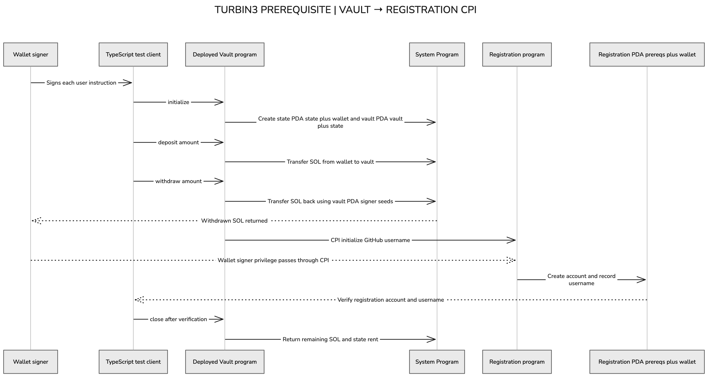

# Turbin3 prerequisite: SOL vault

My Turbin3 Part 1 prerequisite: an Anchor SOL vault that registers my GitHub username, `SomeshTalligeriDEV`, when I withdraw. The main addition is a CPI from the vault to the supplied registration program.

## Architecture

The diagram shows the flow from the TypeScript client through the deployed vault to registration. A few details behind the labels: the wallet signs transactions, `initialize` creates only the state account and validates the vault address, and the first deposit funds the vault. On close, the System Program transfers the remaining vault SOL; Anchor refunds the state account's rent directly.

## Instructions

| Instruction | Effect |
| --- | --- |
| `initialize` | Creates the wallet's state PDA and stores the state and vault bumps. Does not deposit SOL. |
| `deposit(amount)` | Transfers lamports from the signing wallet to its vault through the System Program. |
| `withdraw(amount)` | Transfers lamports back using vault PDA signer seeds, then registers the GitHub username through CPI. |
| `close` | Returns the remaining vault lamports and closes the state account, refunding its rent to the wallet. |

The state account stores two bumps; the SOL balance belongs to the separate, System Program-owned vault account. Amounts are lamports: 1 SOL = 1,000,000,000 lamports.

## PDA seeds

| Account | Seeds before bump | Deriving program |
| --- | --- | --- |
| Vault state | `[b"state", user public-key bytes]` | Vault |
| SOL vault | `[b"vault", vault-state public-key bytes]` | Vault |
| Registration | `[b"prereqs", user public-key bytes]` | Registration |

Each PDA derivation also uses its program ID and bump. The wallet-derived state constraints bind requests to that wallet's vault.

## Withdrawal and registration

1. The wallet signs a call to the deployed vault's `withdraw` instruction.
2. The vault calls the System Program to transfer SOL back. Seeds and the stored bump let the runtime authorize the vault PDA for this CPI.
3. The vault calls registration's `initialize`, passing the wallet, registration PDA, System Program, and `SomeshTalligeriDEV`. This CPI uses the wallet's existing signer privilege, without vault signer seeds.
4. Both calls propagate errors with `?`. A failed registration causes the transaction's state changes, including the transfer, to roll back; transaction fees still apply.

Registration is once per wallet. This implementation calls registration on every withdrawal, so a subsequent withdrawal for an already registered wallet is expected to fail. Closing the vault does not delete its registration.

## Project and verification

- Program: [`programs/pre-req-vault/src`](programs/pre-req-vault/src)
- TypeScript flow and registration assertions: [`tests/pre-req-vault.ts`](tests/pre-req-vault.ts)
- Supplied registration interface: [`idls/registration.json`](idls/registration.json)
- Architecture notes: [`PART1-architecture.md`](PART1-architecture.md)

Devnet vault: `FxogU7GPL6uKMjbY9bNswLtvyHXxKJitopTD9pRp29C`

Registration program: `TRBZyQHB3m68FGeVsqTK39Wm4xejadjVhP5MAZaKWDM`

All four TypeScript tests passed on devnet. Registration was verified before closure, and transaction inspection confirmed the registration call was an inner instruction of the deployed vault. [Withdrawal and registration transaction](https://explorer.solana.com/tx/5AY2f1QHu8tWx4K9xo3oDhvhKTfGNK8PsewJtzAZ455qaGsmRbKcSccPtLcYxMqWHXiLDQAeZWunFd9djeEPbtX5?cluster=devnet).

Local checks: `anchor build` and `pnpm exec tsc --noEmit`. The Rust integration-test file is currently commented out; `cargo test` does not exercise the vault flow. The TypeScript suite submits devnet transactions and must not be rerun casually after registration. Never commit wallet files or recovery phrases.
